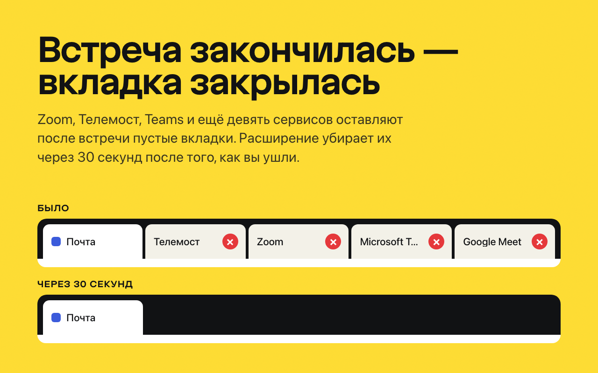
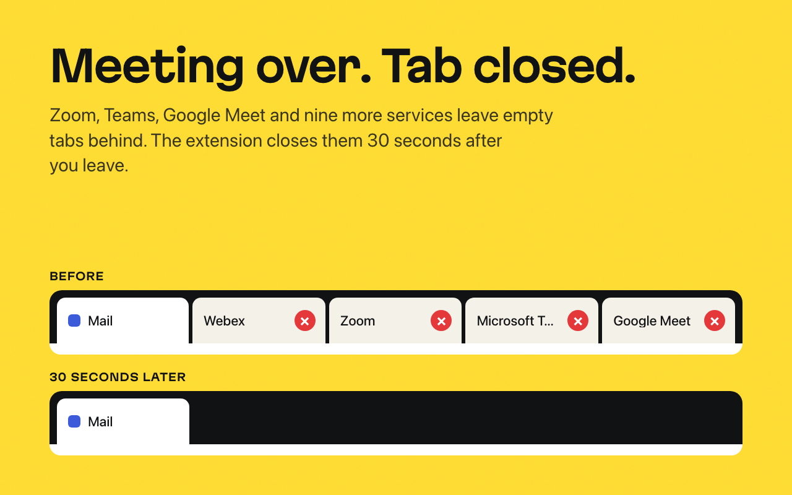

# Чистильщик вкладок видеовстреч

Для тех, кто заходит на встречи по ссылкам из календаря: расширение для
браузеров на Chromium закрывает вкладку видеовстречи через 30 секунд после
того, как она стала не нужна, и не трогает вкладку, где звонок ещё идёт.
Ничего не собирает и не делает ни одного сетевого запроса.



Хвосты бывают двух видов: страница-посредник, которая запустила десктопное
приложение и осталась висеть пустой, и комната в браузере, из которой вы уже
вышли. Двенадцать сервисов видеосвязи, а по желанию ещё Telegram и страницы
входа трёх CLI.

## Установка

Карточка в Chrome Web Store на проверке — ссылка появится здесь. До тех пор
расширение ставится из релиза, это пара минут:

1. Скачайте `meeting-tab-cleaner-<версия>.zip` из
   [последнего релиза](https://github.com/tonyprots/meeting-tab-cleaner/releases/latest)
   и распакуйте в папку, которую не будете удалять.
2. Откройте `chrome://extensions` (в Яндекс Браузере — `browser://extensions`)
   и включите **«Режим разработчика»**.
3. **«Загрузить распакованное расширение»** → распакованная папка.

Нужен браузер на Chromium 111 или новее. Иконки в панели нет, расширение
работает в фоне. Проверить: откройте ссылку на встречу в Телемосте или Zoom,
дайте запуститься приложению — через 30 секунд вкладка исчезнет.

## Что закрывается, а что нет

**Вкладка не на глазах заданное время и ни одна защита не сработала —
закрываем.** Правило одно, и оно само разбирает все случаи:

| Что во вкладке | Что видит расширение | Итог |
|---|---|---|
| встреча идёт в браузере | живое WebRTC-соединение, медиа или звук | не трогаем |
| смотрю на экран входа | вкладка на глазах, обычно ещё и превью камеры | не трогаем |
| жду в зале ожидания в другом окне | страница держит камеру или микрофон | не трогаем |
| вышел из встречи | защиты молчат | закрываем |
| звонок ушёл в приложение | защиты молчат | закрываем |

Закреплённые вкладки и вкладки со звуком не закрываются никогда. Как
устроены защиты и почему им можно доверять — в
[ARCHITECTURE.md](ARCHITECTURE.md).

## Платформы

Сервисы, чьи ссылки запускают приложение, включены сразу. Остальные
включаются галочкой в настройках, и только тогда браузер спросит доступ
к их сайту.

| Сервис | Включён | Проверен |
|---|---|---|
| Яндекс Телемост | сразу | вживую |
| Zoom | сразу | по документации |
| Microsoft Teams (встречи и чаты) | сразу | по документации |
| Cisco Webex | сразу | по документации |
| GoTo Meeting | сразу | по документации |
| Google Meet | галочкой | по документации |
| Контур.Толк | галочкой | по документации |
| МТС Линк | галочкой | по документации |
| СБЕР Джаз | галочкой | по документации |
| Jitsi Meet | галочкой | по документации |
| Whereby | галочкой | по документации |
| Amazon Chime | галочкой | по документации |
| Telegram (после «Открыть в Telegram») | галочкой | по документации |
| Вход в Google Cloud CLI, Cloudflare Wrangler, Claude Code | галочкой | по документации |

«По документации» значит: адреса проверены по документации сервиса и
редиректам, но настоящей встречи с расширением ещё не было. Провели такую —
[расскажите](https://github.com/tonyprots/meeting-tab-cleaner/issues/new?template=platform-verified.yml),
это самая полезная помощь проекту.

## Настройки

Страница настроек (`chrome://extensions` → карточка → «Настройки расширения»):
переключатель на каждую платформу, задержка 30, 60 или 120 секунд, счётчик
закрытых вкладок. У каждой платформы помечено, проверена ли она на живых
звонках.

## Приватность

Расширение не делает сетевых запросов, ничего не отправляет и не хранит,
кроме настроек и счётчика. Разрешения `tabs` нет: адреса всех вкладок ему не
нужны, хватает доступа к доменам самих сервисов. Проверить можно одной
командой:

```bash
grep -rnE "fetch\(|XMLHttpRequest|WebSocket|sendBeacon" extension/
```

Политика конфиденциальности —
[tonyprots.github.io/meeting-tab-cleaner](https://tonyprots.github.io/meeting-tab-cleaner/),
зачем нужно каждое разрешение — в [ARCHITECTURE.md](ARCHITECTURE.md#разрешения).

## Помочь проекту

Проверенная вживую платформа, найденная вкладка, которая не закрылась, или
новый сервис — всё это в [CONTRIBUTING.md](CONTRIBUTING.md), там же тесты и
сборка из исходников. Уязвимость — по [SECURITY.md](SECURITY.md), не в
открытом issue. История версий — [CHANGELOG.md](CHANGELOG.md).

Лицензия MIT. Автор — [Антон Проценко](https://tonyprots.ru).

## English summary



**Meeting Tab Cleaner** closes leftover video-meeting tabs in Chromium
browsers 30 seconds after they stop being useful — the launcher page that
handed the call to the desktop app, or the web room you already left — and
never touches a tab with a live call. One rule: a tab that is out of sight for
the chosen delay and trips none of the guards (live WebRTC connection,
playing media, captured camera or microphone, audio, pinned) is closed.
Twelve meeting services (Yandex Telemost, Zoom, Teams, Webex, GoTo, Google
Meet, Kontur Talk, MTS Link, SBER Jazz, Jitsi, Whereby, Chime), plus optional
Telegram hand-off pages and CLI sign-in pages. Only Telemost has been verified
on live calls so far; if you ran a real meeting on another service, please
[report it](https://github.com/tonyprots/meeting-tab-cleaner/issues/new?template=platform-verified.yml).
No data collection, no network requests. Install from the
[latest release](https://github.com/tonyprots/meeting-tab-cleaner/releases/latest)
as an unpacked extension until the Chrome Web Store listing is approved.
MIT license.
